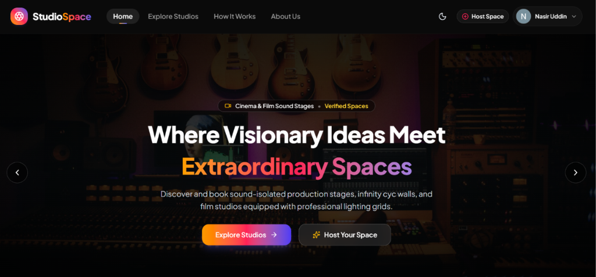

# StudioSpace 🎬 | Peer-to-Peer Creative Workspace & Production Studio Marketplace

[](https://nextjs.org/)
[](https://react.dev/)
[](https://www.typescriptlang.org/)
[](https://tailwindcss.com/)
[](https://www.mongodb.com/)
[](https://expressjs.com/)

<p align="center">
  
</p>

**StudioSpace** is a high-performance peer-to-peer marketplace designed for creators, filmmakers, photographers, podcasters, and musicians. Studio owners and hosts can list their creative spaces—ranging from photography cyc walls and cinema sound stages to podcast lounges, music recording suites, and art workshops. Fellow creators can discover, filter, inspect dynamic availability, and reserve studio slots with transparent pricing and real-time booking management.

---

## 🌐 Live Site & Repository Links

- **Live Application URL:** [https://studiospace-eight.vercel.app](https://studiospace-eight.vercel.app)
- **Client-Side Repository:** [https://github.com/Nasir-Uddin-Mollah/StudioSpace](https://github.com/Nasir-Uddin-Mollah/StudioSpace)
- **Server-Side Repository:** [https://github.com/Nasir-Uddin-Mollah/StudioSpace-Server](https://github.com/Nasir-Uddin-Mollah/StudioSpace-Server)

---

## 🔑 Examiner / Evaluator Test Credentials

Examiners can test the application instantly without manual registration:

| Field | Value |
| --- | --- |
| **Test Email** | `examiner@studiospace.com` |
| **Test Password** | `Examiner123!` |
| **Social Login** | One-Click Google Authentication is fully enabled |
| **Registration** | Any new test account can be registered instantly (No email verification roadblock) |

---

## ✨ Key Features (Minimum 5 Highlights)

1. **Dynamic Studio Marketplace & Instant Category Filtering:**
   Explore curated creative workspaces categorized into *Photo Studios, Film Sound Stages, Podcast Lounges, Music Suites, and Art Workshops*. Includes real-time category filtering and query synchronization directly from MongoDB.

2. **Interactive Hero Banner & Dynamic Featured Workspaces:**
   Features an interactive multi-slide banner with punchy typography and direct CTAs (`Explore Studios` / `Host Your Space`). The homepage dynamically pulls the top 6 highest-rated or latest workspaces using MongoDB `.limit(6)`.

3. **Secure Authentication with Better-Auth & JWT Authorization:**
   Complete authentication suite supporting both Google OAuth and Email/Password sign-in with strict validation (minimum 6 characters, uppercase, and lowercase requirements). All server-side data mutations are protected via secure JWT token authorization (`VerifyToken`).

4. **Complete Listing Lifecycle (Full Host CRUD):**
   Authenticated creators can add spaces via `/add-studio` with direct ImgBB multi-photo upload, manage their own properties in `/my-listings` with Table and Card view toggles, update listing specifications via `/studios/edit/[id]`, and safely delete spaces backed by modal confirmations.

5. **Smart Reservation System with Double-Booking Prevention:**
   Creators can select shoot dates, start times, duration, and crew sizes with an automatic transparent price calculator (Hourly Rate × Hours + Security Deposit). Prevents duplicate booking collisions against already confirmed reservations for the selected time slot.

6. **Interactive Saved Wishlist:**
   One-click bookmarking allows creators to curate their dream production spaces. Wishlist state is synchronized in real time across the application using React Context and backed by persistent MongoDB storage.

7. **Theme Customization (Dark / Light Mode):**
   Full-featured light and dark mode toggle seamlessly integrated across the entire marketplace using `next-themes` and Tailwind CSS v4 design tokens.

8. **Creative 404 & Branded Skeleton Loading:**
   Custom studio-themed 404 page (*"Scene 404 - Lost on Set"*) featuring studio illustrations and home navigation, plus branded aperture spinning skeleton loaders for route transitions.

---

## 🛠️ Tech Stack & Architecture

### Frontend (Client-Side)
- **Framework:** Next.js 16 (App Router)
- **UI Library:** React 19
- **Styling:** Tailwind CSS v4, Base UI, Class Variance Authority (`cva`)
- **Icons:** Lucide React, React Icons (`react-icons/fc`, `react-icons/fa6`)
- **Theme:** `next-themes` (Dark/Light mode support)
- **Notifications:** Custom Toast & Sonner Components
- **Image Hosting:** ImgBB API

### Backend (Server-Side)
- **Runtime & Framework:** Node.js, Express.js
- **Database:** MongoDB Atlas (Native MongoDB Driver)
- **Security & Tokens:** `jose` (JWKS & JWT remote verification), CORS, `dotenv`

---

## 💻 Local Setup & Installation

Follow these steps to run the project locally on your machine:

### 1. Prerequisites
- [Node.js](https://nodejs.org/) (v18.17+ or v20+)
- [Git](https://git-scm.com/)
- A free [MongoDB Atlas](https://www.mongodb.com/) cluster

---

### 2. Clone the Repositories
```bash
# Clone the client-side repository
git clone https://github.com/Nasir-Uddin-Mollah/StudioSpace.git
cd StudioSpace

# Clone the server-side repository in a sibling directory
cd ..
git clone https://github.com/Nasir-Uddin-Mollah/StudioSpace-Server.git
```

---

### 3. Server-Side Configuration
1. Navigate to the server folder:
   ```bash
   cd StudioSpace-Server
   npm install
   ```
2. Create a `.env` file in the root of `StudioSpace-Server`:
   ```env
   PORT=5000
   MONGODB_URI=your_mongodb_connection_string
   CLIENT_URL=http://localhost:3000
   ```
3. Start the backend development server:
   ```bash
   npm run dev
   # Server will run on http://localhost:5000
   ```

---

### 4. Client-Side Configuration
1. Navigate to the client folder:
   ```bash
   cd ../StudioSpace
   npm install
   ```
2. Create a `.env.local` file in the root of `StudioSpace`:
   ```env
   MONGODB_URI=your_mongodb_connection_string
   BETTER_AUTH_SECRET=your_better_auth_secret_key
   BETTER_AUTH_URL=http://localhost:3000
   OAUTH_CLIENT_ID=your_google_oauth_client_id
   OAUTH_CLIENT_SECRET=your_google_oauth_client_secret
   NEXT_PUBLIC_IMGBB_API_KEY=your_imgbb_api_key
   NEXT_PUBLIC_SERVER_URL=http://localhost:5000
   ```
3. Start the Next.js development server:
   ```bash
   npm run dev
   ```
4. Open your browser and navigate to [http://localhost:3000](http://localhost:3000).

---

## 🔒 Security & Route Protection
- **Private Routes (`/add-studio`, `/my-listings`, `/my-bookings`, `/wishlist`):** Protected on both client and server layers. Unauthenticated users attempting to access these routes or click "Book Workspace Now" are automatically redirected to the `/login` page with return `callbackUrl` preservation.
- **Data Protection:** All MongoDB mutations (`POST /studios`, `DELETE /studios/:id`, `PATCH /studio/:id`, `POST /bookings`) require a valid Bearer JWT token in the Authorization header.
